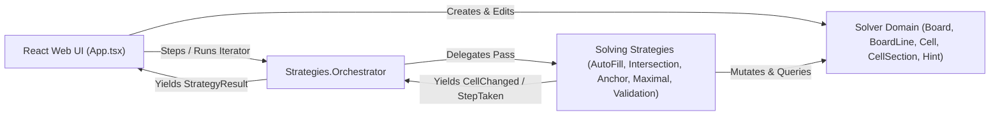

# Architecture Overview

**Last Updated**: 06/11/2026 18:44
**Related Docs**: [`DEC_001`](../decisions/DEC_001-strategy-generator-contract.md), [`DEC_002`](../decisions/DEC_002-atomic-cell-yielding-and-structured-results.md), [`DEC_003`](../decisions/DEC_003-pure-logical-mapping-and-domain-enrichment.md), [`SRQ_001`](../requisites/system/SRQ_001-generator-strategy-execution.md), [`URQ_001`](../requisites/user/URQ_001-interactive-nonogram-board.md)

## System Vision

Nonosolver is an interactive web application built with React 19, TypeScript, and Vite for building, visualizing, and solving nonogram (picross) puzzles of arbitrary grid dimensions. The architecture strictly separates the pure domain and solving engine (`src/solver/`) from the React user interface (`src/App.tsx`), communicating step-by-step solving progress via TypeScript Generator iterators.

## Module Boundaries

### 1. Core Solver Domain (`src/solver/`)
The domain layer models the mathematical structure of a nonogram grid and provides rich, side-effect-explicit helper namespaces:
- **[`CellStatus`](../../src/solver/CellStatus.ts)**: Enum representing the three possible states of any grid coordinate: `Unknown` (`0`, `.`), `Filled` (`1`, `o`), and `Empty` (`2`, `x`).
- **[`Hint`](../../src/solver/Hint.ts)**: Branded positive integer type (`number & { readonly __brand: unique symbol }`) validated via `Hint.of(value)` to ensure all row and column clues are strictly positive integers.
- **[`Cell`](../../src/solver/Cell.ts)**: Represents a single board intersection holding its mutable `status: CellStatus` and bidirectional references to its parent `row: BoardLine` and `col: BoardLine`.
- **[`CellSection`](../../src/solver/CellSection.ts)**: Value object describing a contiguous 1D slice of cells (`startIndex`, `endIndex`, `size`, `status`), supporting creation, cloning, console printing, and adjacent status merging.
- **[`BoardLine`](../../src/solver/BoardLine.ts)**: Combines `hints: Hint[]` and `cells: Cell[]` for a single row or column. Its companion namespace provides domain-intrinsic operations required by strategies:
  - `getMinimalPositionsFromStart` and `getMinimalPositionsFromEnd`: Compute earliest/latest tight packings of hints as `CellSection[]`.
  - `split(line, byStatus?)`: Partitions a line into contiguous `CellSection` blocks, optionally treating a target status (such as `CellStatus.Empty`) as a delimiter while merging non-delimiter statuses.
  - `isCompleted(line)`: Checks whether all `Filled` sections in the line match the count and exact sizes of `line.hints`.
  - `cellsAt(line, sec)`: Extracts the `Cell[]` subset corresponding to a `CellSection`.
- **[`Board`](../../src/solver/Board.ts)**: Aggregates `size`, `rows: BoardLine[]`, and `cols: BoardLine[]` from a `BoardTemplate`. Shared `Cell` instances are wired into both `rows` and `cols` so mutations on a row immediately reflect in the intersecting column.
- **[`Examples`](../../src/solver/Examples.ts)**: Predefined `BoardTemplate` fixtures (`small` 5x5 and `medium` 10x10) for testing and demonstration.

### 2. Strategy Engine (`src/solver/strategies/`)
Solving algorithms are encapsulated as stateless TypeScript Generator functions adhering to the [`Strategy`](../../src/solver/strategies/Strategy.ts) contract:
- **[`Strategy` & `StrategyResult`](../../src/solver/strategies/Strategy.ts)**: Every strategy accepts a `Board`, yields [`StrategyResult.CellChanged`](../../src/solver/strategies/Strategy.ts) (or `StepTaken`) immediately upon mutating a cell, and returns a terminal `StrategyResult` (`Completed`, `Faulted`, or `Stalled`), always carrying `strategyName`.
- **[`Strategies.Orchestrator`](../../src/solver/strategies/Strategies.ts)**: Composes an ordered list of `Strategy` generators, iterating through them in passes until `Board.isCompleted(board)` is true (`Completed`), a strategy reports an impossible board (`Faulted`), or a full pass across all strategies produces zero cell changes (`Stalled`).
- **Strategy Families** (detailed in [./strategies/](./strategies/summary.md)):
  - **AutoFill**: Quality-of-life completion passes (`AutoFill.CompleteLine`).
  - **Intersection**: Overlap calculation between earliest and latest hint placements (`Intersection.Basic`, `Intersection.Smart`, `Intersection.Perfect`).
  - **Anchor**: Boundary-driven deductions from line starts and ends (`Anchor.Start`, `Anchor.End`, `Anchor.Composite`, `Anchor.Overlap`).
  - **Maximal**: Deductions around hints matching the global or remaining maximum clue size (`Maximal.Basic`, `Maximal.Advanced`).
  - **Validation**: Sanity checkers that detect impossible board states (`Validation.OversizedBlock`, `Validation.InsufficientSpace`, `Validation.UnmatchableBlock`).

### 3. Interactive Web UI (`src/App.tsx` & `src/components/`)
The single-page React interface coordinates board editing and generator playback:
- **[`App.tsx`](../../src/App.tsx)**: Manages immutable `Board` state snapshots (via `Board.clone`), grid size & preset controls (`Small 5x5`, `Medium 10x10`, `Blank`), the bottom `Filling` vs. `Empty` mode switch, active strategy selection, and the generator playback loop (`Step`, `Run`/`Pause`, `Reset Cells`, and step interval slider).
- **[`NonogramBoard.tsx`](../../src/components/NonogramBoard.tsx)**: Renders the CSS Grid layout aligning column hint headers, row hint headers, `-`/`+` hint count buttons at the start of every line, 5-cell major guide borders, and 3-state interactive cell buttons (`Unknown`, `Filled`, `Empty`).
- **[`HintInput.tsx`](../../src/components/HintInput.tsx)**: Focus-activated hint editor that displays the clue number cleanly when unfocused and enables numeric editing + `−`/`+` stepper buttons only when focused.
